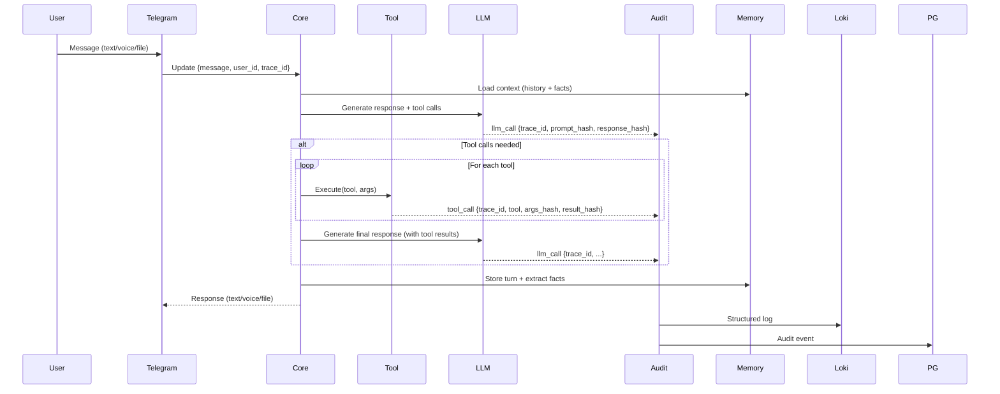

# MAVIS — Architecture Deep Dive

> This document captures the *why* behind major decisions. Implementation details are in the private repo.

---

## 1. Context & Constraints

**Business context:** MAVIS is a personal AI assistant deployed as a daily driver across Telegram, Slack, and email. It must handle: persistent memory, 15+ tools, voice I/O, file generation, and governance — all self-hosted for privacy.

**Regulatory constraints:**
- GDPR (personal data processing, right to erasure)
- No data leaves self-hosted infrastructure
- Audit trail for AI decisions (personal accountability)
- PII redaction in logs

**Technical constraints:**
- Single Docker container deployment (simplicity)
- <2GB RAM, 1 vCPU (cost control)
- Latency budget: <2s for tool calls, <5s for LLM responses
- Must run on Railway/Cloud Run/any Docker host

**Non-goals:**
- Multi-user SaaS (single-tenant by design)
- Real-time voice conversation (push-to-talk only)
- Custom model training

---

## 2. High-Level Architecture

```mermaid
%%{init: {'theme': 'base', 'themeVariables': {
  'primaryColor': '#0B2D4A',
  'primaryTextColor': '#fff',
  'primaryBorderColor': '#00C9A7',
  'lineColor': '#888',
  'secondaryColor': '#1A1A2E',
  'tertiaryColor': '#E85D4D',
  'background': 'transparent',
  'mainBkg': 'transparent',
  'secondBkg': 'transparent',
  'tertiaryBkg': 'transparent'
}}}%%
flowchart TB
    subgraph Interface[User Interfaces]
        TG[Telegram Bot API]
        SL[Slack Socket Mode]
        EM[n8n Webhooks / Email]
    end
    subgraph Runtime[Hermes Agent Container]
        Core[Core Loop]
        Mem[Memory Manager]
        Tool[Tool Registry]
        Soul[SOUL.md Guardrails]
        Sched[APScheduler]
    end
    subgraph Tools[Tools]
        Gmail[Gmail/Calendar API]
        Notion[Notion API]
        SlackAPI[Slack Web API]
        Search[DuckDuckGo Search]
        Files[File Gen: docx/pptx/pdf]
        TTS[ElevenLabs TTS]
        STT[faster-whisper STT]
        YTDLP[yt-dlp Video Download]
    end
    subgraph LLM[LLM Providers]
        Opus[Claude Opus]
        Sonnet[Claude Sonnet]
        GPT[GPT-4o]
    end
    subgraph Governance[Governance]
        Audit[Audit Logger]
        Eval[Eval Harness]
        Risk[Risk Register]
    end
    subgraph Data[Data Layer]
        PG[(Supabase PostgreSQL)]
        FileMem[(Hermes File Memory)]
        Loki[(Loki Logs)]
    end

    TG --> Core
    SL --> Core
    EM --> Core
    Core --> Mem
    Core --> Tool
    Core --> Soul
    Core --> Sched
    Tool --> Gmail
    Tool --> Notion
    Tool --> SlackAPI
    Tool --> Search
    Tool --> Files
    Tool --> TTS
    Tool --> STT
    Tool --> YTDLP
    Core --> Opus
    Core --> Sonnet
    Core --> GPT
    Mem --> PG
    Mem --> FileMem
    Core --> Audit
    Audit --> Loki
    Audit --> PG
    Eval --> Audit
    Risk --> PG

    style Interface fill:#0B2D4A,color:#fff
    style Runtime fill:#1A1A2E,color:#fff
    style Tools fill:#1A1A2E,color:#fff
    style LLM fill:#00C9A7,color:#0B2D4A
    style Governance fill:#E85D4D,color:#fff
    style Data fill:#00C9A7,color:#0B2D4A
```

---

## 3. Key Design Decisions (ADR Summaries)

| ADR | Decision | Rationale | Trade-offs |
|-----|----------|-----------|------------|
| [001](docs/adr/001-use-hermes-agent.md) | Hermes Agent over custom Python orchestrator | Built-in personality, tool registry, memory, extensible, active community | Learning curve, smaller ecosystem than LangChain |
| [002](docs/adr/002-soul-md-design.md) | SOUL.md for personality + guardrails | Version-controllable, hot-reloadable, non-technical editable, encodes behavioral constraints | Markdown parsing complexity |
| [003](docs/adr/003-audit-log-design.md) | Structured JSONL + trace IDs + OpenTelemetry-ready | Queryable, correlates with traces, compliance-ready | Storage volume, schema evolution |
| [004](docs/adr/004-tool-registry.md) | Explicit tool schemas in SOUL.md + Python implementations | Type-safe, self-documenting, eval-harness compatible | Boilerplate per tool |
| [005](docs/adr/005-eval-harness.md) | Custom harness + regression + red-team gates | Domain-specific thresholds, blocks bad deploys | Maintenance burden |

---

## 4. Agent / Component Specs

### `Hermes Core` — Agent Runtime
- **Trigger:** Incoming message (Telegram/Slack/n8n) or scheduled job
- **Inputs:** `{ message, user_id, chat_id, trace_id, context }`
- **Tools:** 15+ (defined in SOUL.md + Python implementations)
- **Outputs:** `{ response, tool_calls, trace_id, metadata }`
- **Governance:** Every turn emits `agent_turn` audit entry with full trace
- **Failure modes:** LLM timeout → fallback model; tool error → graceful degradation message

### `SOUL.md Guardrails` — Personality + Constraints
- **Format:** YAML frontmatter + Markdown sections
- **Sections:** Identity, Values, Behavioral Rules, Tool Schemas, Guardrails, Preferences
- **Enforcement:** Validated at startup; hot-reload on file change; eval harness tests guardrail adherence
- **Key guardrails:** No PII in logs, no financial advice without disclaimer, no code execution, escalation phrases for crisis

### `Tool Registry` — 15+ Tools
| Tool | Purpose | Governance |
|------|---------|------------|
| `gmail_send` | Send email | Requires confirmation for external recipients |
| `gmail_read` | Read inbox | PII redaction in logs |
| `calendar_create` | Create event | Audit log entry |
| `notion_create_page` | Create Notion page | Structured output |
| `slack_post` | Post to Slack | Channel allowlist |
| `web_search` | DuckDuckGo search | No auto-click |
| `file_gen_docx` | Generate .docx | Template validation |
| `file_gen_pptx` | Generate .pptx | Template validation |
| `tts_elevenlabs` | Text-to-speech | Cost tracking |
| `stt_whisper` | Speech-to-text | Local processing |
| `yt_dlp` | Download video | Size/time limits |

### `Memory Manager` — Persistent + Structured
- **Conversation history:** Full message log (Supabase, encrypted at rest)
- **Structured facts:** Extracted entities, preferences, commitments (Supabase + Hermes file memory)
- **Retrieval:** Semantic search via pgvector + keyword
- **Privacy:** User can request full export/deletion (GDPR Art. 15/17)

---

## 5. Data Flow & State Management

**State persistence:** Supabase PostgreSQL (conversations, facts, audit) + Hermes file memory (local embeddings, short-term)  
**Idempotency:** `trace_id` (UUID v7) per user message; all downstream operations carry it  
**Consistency model:** Eventual for fact extraction; strong for conversation history

---

## 6. Governance Implementation

### Audit Logging
- **Every LLM call:** `trace_id`, `prompt_hash`, `response_hash`, `latency_ms`, `token_count`, `model_version`, `temperature`
- **Every tool call:** `trace_id`, `tool_name`, `args_hash`, `result_hash`, `duration_ms`, `success`, `error?`
- **Every agent turn:** `trace_id`, `user_id`, `input_hash`, `output_hash`, `tools_used`, `guardrails_triggered`
- **Storage:** Loki (30-day hot) + PostgreSQL (7-year cold) + S3 (raw payloads, 90-day)

### Eval Harness
| Suite | Frequency | Gate | Threshold |
|-------|-----------|------|-----------|
| Regression | PR + nightly | Block merge | 95% pass |
| Red-team | Weekly | Alert | 0 critical |
| Guardrail adherence | PR | Block merge | 100% |
| Cost regression | Daily | Alert | >20% increase |

### Risk Register (Living Document)
| ID | Risk | Likelihood | Impact | Mitigation | Owner | Status |
|----|------|------------|--------|------------|-------|--------|
| R-01 | PII leakage in logs | Medium | High | Redaction pipeline + schema validation | Jane | Active |
| R-02 | Unintended tool execution | Low | High | Confirmation prompts for destructive actions | Jane | Active |
| R-03 | LLM cost overrun | Medium | Medium | Daily budget alerts + fallback to Sonnet | Jane | Monitored |
| R-04 | Guardrail bypass via prompt injection | Low | Critical | Red-team testing + SOUL.md hardening | Jane | Active |

---

## 7. Failure Modes & Runbooks

| Scenario | Detection | Mitigation | Runbook |
|----------|-----------|------------|---------|
| LLM API degradation | Latency > p99, error rate > 1% | Fallback to Sonnet/GPT-4o, circuit breaker | `runbooks/llm-degradation.md` |
| Audit log backpressure | Loki queue > 10k | Buffer to S3, alert | `runbooks/audit-backpressure.md` |
| Tool API rate limit | 429 responses | Exponential backoff, user notification | `runbooks/tool-rate-limit.md` |
| Memory corruption | Supabase query errors | Automated backup restore, alert | `runbooks/memory-corruption.md` |

---

## 8. Scaling & Cost Model

| Component | Current Scale | Projected (12mo) | Cost Driver | Optimization |
|-----------|---------------|------------------|-------------|--------------|
| LLM calls | 10k/day | 100k/day | Token volume | Caching, routing to Sonnet, prompt compression |
| Tool calls | 5k/day | 50k/day | API fees | Batching, caching, local alternatives |
| TTS/STT | 100/day | 1k/day | ElevenLabs credits | faster-whisper local for STT |
| Audit logs | 1GB/day | 10GB/day | Ingestion + retention | Tiered storage, compression |

---

## 9. Future Work (Roadmap)

- [ ] **MCP integration** for standardized tool interfaces
- [ ] **On-device LLM fallback** (llama.cpp/MLX) for offline mode
- [ ] **Formal guardrail verification** (Constitutional AI testing)
- [ ] **Multi-user support** (isolated workspaces)
- [ ] **Voice conversation mode** (WebRTC + streaming STT/TTS)
- [ ] **Plugin marketplace** for community tools

---

*Architecture owned by Jane Riveros — questions: `jdriveros232@gmail.com`*