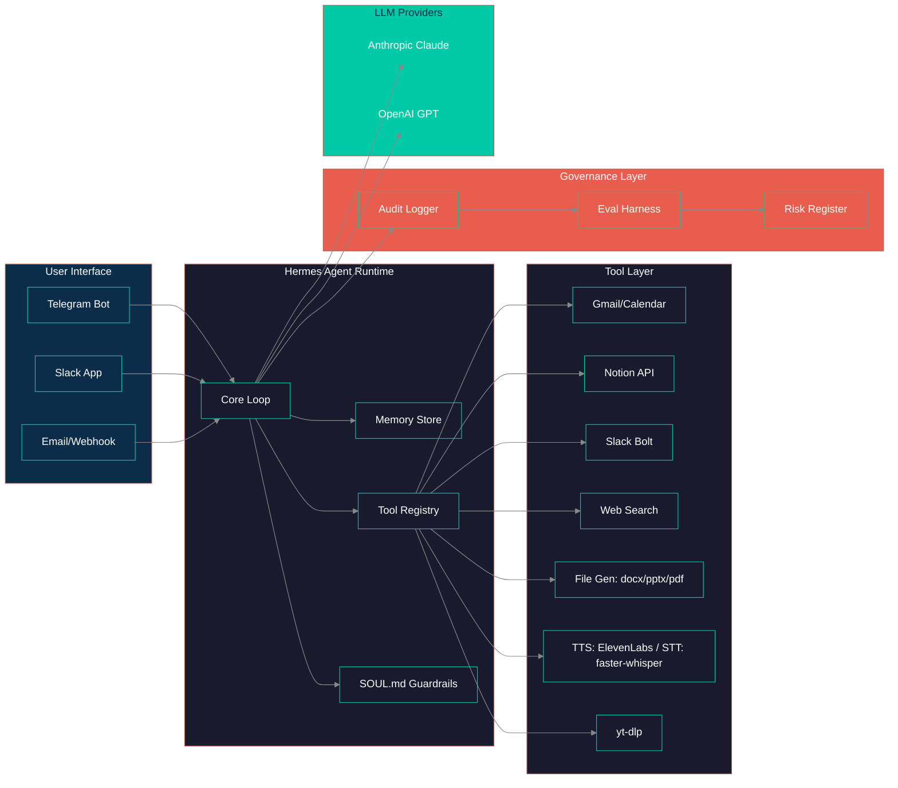

# MAVIS — Personal AI Showcase
**Telegram AI agent with tools, persistent memory, voice I/O, and governance — built on Hermes Agent.**  
*Public architecture showcase — implementation is private.*

[]()
[]()
[]()

---

## 🎯 Problem & Outcome

**Problem:** Personal AI assistants are either toy chatbots (no tools, no memory) or enterprise platforms (overkill, no privacy). There's no production-grade personal agent that combines: persistent cross-session memory, rich tool ecosystem (email, calendar, files, web), voice I/O, and governance guardrails — all running locally/self-hosted.

**Outcome:**
- `Daily driver`: 50+ interactions/day across Telegram, Slack, email
- `Tool coverage`: 15+ tools (Gmail, Calendar, Notion, Slack, web search, file gen, TTS/STT, yt-dlp)
- `Memory persistence`: Full conversation history + structured facts across sessions
- `Governance`: SOUL.md personality + behavioral guardrails + structured audit logs + eval harness
- `Deployment`: Single Docker image (Hermes Agent + SOUL.md + yt-dlp + faster-whisper)

**Domain:** Personal Productivity / AI Agent Infrastructure · **Privacy-first:** Self-hosted, no data leaves your infrastructure

---

## 🎥 Demo

| Format | Link |
|--------|------|
| **Full walkthrough (5-8 min)** | [🎥 YouTube / Loom / Vimeo](https://...) |
| **Quick demo (60 sec GIF)** |  |
| **Architecture narrated (3 min)** | [🎥 Link](https://...) |

---

## 📐 Architecture

### System Overview


### High-Level Data Flow (Excalidraw)
  
*Hand-drawn style for architectural thinking — [editable Excalidraw file](diagrams/system-overview.excalidraw)*

### Key Components

| Component | Responsibility | Tech | Governance Hook |
|-----------|----------------|------|-----------------|
| `Hermes Core` | Agent loop, memory, tool calling, streaming | `nousresearch/hermes-agent` (Docker) | Emits structured logs for every turn |
| `SOUL.md` | Personality, behavioral guardrails, tool schemas | Markdown + YAML frontmatter | Validated at startup; hot-reloadable |
| `Tool Registry` | 15+ tools: Gmail, Calendar, Notion, Slack, Search, Files, Voice, Video | Python functions + n8n webhooks | Each call logged with trace_id, args/result hashes |
| `Memory Store` | Conversation history + structured facts (Supabase) | Supabase PostgreSQL + Hermes file-based | PII redaction before persistence |
| `Audit Logger` | JSONL + OpenTelemetry spans | Custom logger → Loki + PostgreSQL | Immutable, queryable, retention policy |
| `Eval Harness` | Regression + red-team + guardrail validation | Python (pytest) + custom thresholds | Blocks deployment on failure |

---

## ⚙️ Tech Stack (What I Built vs. Leveraged)

| Layer | Built by Me | Leveraged / Configured |
|-------|-------------|------------------------|
| **Orchestration** | SOUL.md personality, tool schemas, guardrail rules, custom eval harness | Hermes Agent runtime, python-telegram-bot, APScheduler |
| **LLM Interface** | Prompt templates, structured output parsing, fallback chains (Opus→Sonnet) | Anthropic SDK, OpenAI SDK |
| **Tools/Integrations** | Custom tools: Gmail, Calendar, Notion, Slack, web search, file gen (docx/pptx/pdf), TTS, STT, yt-dlp | ElevenLabs, faster-whisper, n8n webhooks, duckduckgo-search |
| **Data & Persistence** | Conversation state, user prefs, scheduled jobs, fact extraction | Supabase (PostgreSQL), Hermes file-based memory |
| **Eval & Governance** | **Custom eval harness, structured audit logs, SOUL.md guardrails, threshold gates** | (Private — not in showcase) |
| **Infra & Deploy** | Dockerfile (Hermes + SOUL.md + yt-dlp + faster-whisper), n8n cloud webhooks | Docker, n8n cloud, GitHub Actions (CI) |
| **Frontend/Viz** | Telegram/Slack interfaces, Markdown rendering | python-telegram-bot, slack-bolt |

> **Governance-by-design note:** Every LLM call emits trace ID → audit log → eval harness. SOUL.md encodes behavioral guardrails at the personality layer. No "black box" paths to user.

---

## 🛡️ Governance & Compliance Artifacts

| Artifact | Location | Purpose |
|----------|----------|---------|
| **Model Card** | `docs/model-card.md` | Intended use, limitations, eval results, data lineage |
| **Risk Register** | `docs/risk-register.csv` | Identified risks, likelihood, impact, mitigations, owner |
| **Eval Harness** | `evals/` | Regression tests, red-team prompts, threshold gates |
| **Audit Log Schema** | `docs/audit-log-schema.json` | Structured schema for every decision trace |
| **ADRs** | `docs/adr/` | Architecture Decision Records (numbered, dated) |
| **SOUL.md** | `docs/soul.md` | Personality + behavioral constraints (Hermes Agent) |

---

## 🚀 How to Run (High-Level)

> **Implementation is private.** This section describes the *operational model* for reference.

```bash
# 1. Infrastructure (Docker)
docker compose up -d  # Hermes + Postgres + Redis

# 2. Configure SOUL.md
cp SOUL.md.example SOUL.md
# Edit with your API keys, preferences, guardrails

# 3. Run eval harness
cd evals && python -m pytest --tb=short

# 4. Deploy to Railway/Cloud Run (optional)
# Docker image pushed to registry; env vars via secrets manager
```

**Environment variables required** (see `.env.example` in private repo):
- `ANTHROPIC_API_KEY`, `OPENAI_API_KEY`, `ELEVENLABS_API_KEY`, `TELEGRAM_BOT_TOKEN`, `SLACK_BOT_TOKEN`, `SLACK_APP_TOKEN`, `SUPABASE_URL`, `SUPABASE_ANON_KEY`, `SUPABASE_SERVICE_ROLE_KEY`, `N8N_WEBHOOK_URL`, `N8N_WEBHOOK_SECRET`, `EVAL_THRESHOLD`, `AUDIT_LOG_LEVEL`, `HERMES_HOME`

---

## 📁 Repository Structure

```
mavis-showcase/
├── README.md                    ← This file
├── ARCHITECTURE.md              ← Deep-dive: decisions, trade-offs, failure modes
├── diagrams/
│   ├── system-overview.mermaid  ← Mermaid source for system diagram
│   ├── system-overview.svg      ← Excalidraw export (architecture)
│   ├── data-flow.mermaid
│   ├── data-flow.svg
│   ├── sequence-message.mermaid
│   ├── sequence-tool.mermaid
│   └── sequence-voice.mermaid
├── assets/
│   ├── demo.gif                 ← 60-sec demo GIF (<2MB, 720p)
│   ├── screenshot-telegram.png  ← Telegram chat (1440px)
│   ├── screenshot-slack.png     ← Slack interaction
│   └── screenshot-tools.png     ← Tool registry view
├── docs/
│   ├── model-card.md
│   ├── risk-register.csv
│   ├── audit-log-schema.json
│   ├── soul.md                  ← SOUL.md personality + guardrails
│   └── adr/
│       ├── 001-use-hermes-agent.md
│       ├── 002-soul-md-design.md
│       ├── 003-audit-log-design.md
│       ├── 004-tool-registry.md
│       └── 005-eval-harness.md
└── evals/
    ├── test_regression.py
    ├── test_redteam.py
    └── thresholds.yaml
```

---

## 🔗 Private Repo Access

**Full implementation, CI/CD, infra-as-code, and eval runs** are in a private repository.

**Access process:**  
1. Initial screening call (30 min)  
2. Mutual NDA (template provided)  
3. Temporary read access to private repo + 1-hour walkthrough with me  
4. Access revoked after evaluation period

**Contact:** `jdriveros232@gmail.com` — subject: `MAVIS Private Repo Access`

---

## 📌 Related Showcases

- [Novaxis OS / Atlas](https://github.com/testaiprojects1-sketch/novaxis-showcase)
- [Mission Control](https://github.com/testaiprojects1-sketch/mission-control-showcase)
- [Dental Clinic Platform](https://github.com/testaiprojects1-sketch/dental-clinic-showcase)
- [Tattoo Artist Platform](https://github.com/testaiprojects1-sketch/tattoo-platform-showcase)
- [All showcases](https://github.com/testaiprojects1-sketch?tab=repositories&q=showcase)

---

*Part of the **testaiprojects1-sketch** AI Systems Engineering portfolio — Governance by Design.*